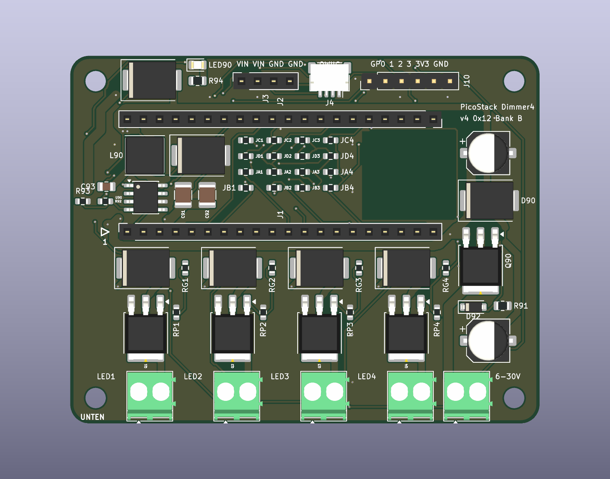

<p align="center">
  
</p>

<h1 align="center">PicoStack</h1>

<p align="center">
  <b>Stackable, contract-driven modules for the Raspberry Pi Pico. No module firmware: the Pico drives everything.</b><br>
  Open hardware, generated by code, verified by tests that are proven to fail.
</p>

<p align="center">
  <a href="hardware/LICENSE"></a>
  <a href="LICENSE"></a>
  
  
</p>

<p align="center">
  
</p>

---

**One board plus a Pico is a working device.** Every PicoStack module is a
74 × 58 mm board with two 1×20 stacking sockets in the Pico's own geometry.
The Pico plugs into the top of the stack; all 40 pins run down through it.
Each module carries its own 6–30 V input (reverse-polarity protection,
TVS, a 3 A buck to 5 V, a Schottky into VSYS), so you can also just power
the Pico over USB while you program it and the module's logic is live.

**v3 is deliberately dumb.** v1/v2 gave every module its own microcontroller,
a token chain to address it and a bootloader path to flash it through the
stack. None of that ever ran on a desk, and none of it was needed for the
exhibits this was built for. v3 removes it: the Pico drives each channel
directly through a GPIO *bank*. The 16 PWM-capable pins GP7–GP22 are split
into four banks (A–D) of four; a module picks its bank with a 0603 solder
matrix on the board (factory default: motor = A, dimmer = B, so one motor
and one dimmer stack without touching an iron). GP26–28 serve analog
signals, GP4/GP5 come out as a Qwiic port, GP6 is a wired-AND emergency
stop, GP0–GP3 sit on a user header.

```python
import picostack                      # firmware/pico/picostack.py (MicroPython)
led = picostack.Dimmer(kanaele=4)     # bank B by default
led.set(1, 0.5)                       # channel 1 at 50 %
```

**The unusual part: these boards are not drawn, they are built.**
Schematics, placement, routing, ground stitching and the manufacturing
checks all come from Python that runs headless against KiCad. The stack's
mechanical and electrical rules live in one machine-readable file, the
*contract* ([`tools/stack_spec.py`](tools/stack_spec.py), rendered as
[docs/vertrag.md](docs/vertrag.md)), and every board is measured against it
before it may exist. The full v3 rationale is in the
[design spec](docs/superpowers/specs/2026-11-15-picostack-v3-design.md).

## Boards (v3, contract v4)

| Board | What it does | State |
|---|---|---|
| Dimmer1 / Dimmer3 / Dimmer4 | 1, 3 or 4 low-side PWM channels, 3 A each (4 A per module), screw terminals | routed, DRC 0/0, fab files in `hardware/fertigung/` |
| Motor | DRV8876 H-bridge, 2.5 A, hardware emergency stop, current sense on GP26 | next: rebuilt on the v3 contract |

Placement follows the current, not the autorouter: FETs sit right above
their terminals (tab down, leads up), free-wheel diodes above the FETs,
the buck converter under the Pico at the USB end, the 4 A trunk is
pre-wired by hand (1.4 mm) and the router only fills in the signals.
The Pico W antenna zone between the socket rows is copper-free on both
layers.

## Why you might care

- **You want motorized / sensor / whatever hats for the Pico** that stack
  instead of sprawling across a desk, with industrial-ish screw terminals
  and a 6–30 V input, and you'd rather not maintain firmware for a second
  microcontroller on every board.
- **You want to see a fully generative KiCad workflow**: schematic
  generators, a hand-placed description, headless routing
  ([KiCadRoutingTools](https://github.com/drandyhaas/KiCadRoutingTools)),
  copper-pour healing (`tools/pcb/masseheiler.py`), DRC and a
  current-capacity gate that walks every power net's real copper path
  (`tools/pcb/strombelastung.py`), all from the command line
  (`tools/pcb/verlegen_v3.sh dimmer4`).
- **You like tests that can actually fail.** Every check in this repository
  ships with a proof that it turns red when the thing it guards is broken.
  ERC and DRC caught *none* of the real bugs found during development,
  including a fail-unsafe emergency-stop gate, a reverse-polarity FET wired
  as a crowbar, a 0.25 mm neck in a 4 A trunk, and a board height at which
  a module mounted upside-down would have plugged in. See
  [tests/](tests/) and `tests/run_all.py`.

## Repository layout

```text
tools/stack_spec.py   the contract (v4)
tools/sch/            schematic generators (versorgung.py, dimmermodul.py)
tools/pcb/            placement descriptions, build.py, router driver, probes
tools/fertigung.sh    gerbers + BOM/CPL for JLCPCB
tests/                plain-python suites (no pytest needed), tests/run_all.py
firmware/pico/        MicroPython library for the Pico
hardware/kicad/       generated .kicad_sch + built .kicad_pcb per board
hardware/fertigung/   gerber zip, jlc-bom.csv, jlc-cpl.csv per board
docs/                 project website, vertrag.md, specs
```

## Building the boards yourself

You need KiCad 10, Python 3, and
[KiCadRoutingTools](https://github.com/drandyhaas/KiCadRoutingTools)
(with numpy/scipy/shapely; `verlegen_v3.sh` wraps it in a nix-shell).

```bash
python3 tests/run_all.py                 # every suite, no board tools needed
tools/pcb/verlegen_v3.sh dimmer4         # schematic -> board -> routed -> DRC + probes
tools/fertigung.sh dimmer4               # gerbers, BOM, CPL
```

## Getting boards made

Gerbers, JLC-format BOM/CPL and the list of hand-populated parts for all
three dimmer boards live under `hardware/fertigung/{dimmer1,dimmer3,dimmer4}/`.
[`hardware/fertigung/ORDERING.md`](hardware/fertigung/ORDERING.md) walks
through ordering an assembled board at JLCPCB. The stacking headers
(Pimoroni Pico Stacking Headers, 1×20 and a 1×4 cut from one) and the user
header are soldered by hand, in the plugged-together stack, so the contacts
line up without strain. **No v3 board has been manufactured yet.**

## Contributing a module

A module is a 74 × 58 mm board that keeps the contract: socket rows and
power row on their contract positions, terminals flush with the bottom
edge, nothing taller than 8 mm under the Pico, the antenna zone free, and
a bank matrix for its signals. Start by copying
`tools/pcb/spec_dimmer_basis.py` and `tools/sch/dimmermodul.py`, then read
[CONTRIBUTING.md](CONTRIBUTING.md).

## License

- **Hardware** (everything under `hardware/`): [CERN-OHL-S-2.0](hardware/LICENSE).
- **Code** (tools, generators, firmware): [GPL-3.0-or-later](LICENSE).
- **Documentation**: CC-BY-SA 4.0.

## Project language

The public face of this project is English. Code comments are German,
they carry the engineering rationale of every decision. New contributions
should be in English.
